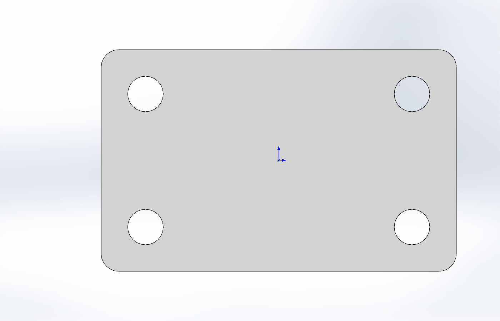

# solidworks-bridge

**Drive SOLIDWORKS 2025 from the command line. One command, one JSON line, millimetres.**

A thin, late-bound COM bridge that lets scripts and coding agents build and inspect
SolidWorks parts without touching the UI. Every subcommand prints exactly one JSON
object, so the caller can verify each step instead of guessing from the screen.

> 非官方项目。与 Dassault Systèmes 无关，不使用任何官方 SDK，只是调用本机已安装的
> SOLIDWORKS 所提供的 COM 接口。请在你拥有合法授权的 SOLIDWORKS 上使用。

| | |
|---|---|
| 平台 | Windows |
| 目标 | SOLIDWORKS 2025（在 33.5.0 上验证；2021+ 大概率可用，未逐一测试） |
| 依赖 | Python 3.8+、`pywin32` |
| 单位 | 命令行一律毫米，内部换算成米 |
| 输出 | 每命令一行 JSON |



## 为什么会有这个东西

SOLIDWORKS 没有官方 MCP，也没有跨平台的自动化接口。用界面自动化（截图 + 点菜单）
慢且脆；直接写 COM 脚本每次都要重新处理一堆坑（参数个数、按引用传值、零参方法被
暴露成属性……）。这个项目把那些坑填平，留一个稳定的命令行边界：

- 一步一条命令，返回结构化结果，失败带 `error` 与 traceback
- 每步都能用 `info` 核对体积和包围盒，不靠"看起来对"
- 全本地运行，不联网、不上传模型

## 安装

```powershell
git clone <this-repo>
cd solidworks-bridge
py -3 -m pip install -r requirements.txt
```

脚本会按顺序找 Python：`$env:SW_PYTHON` → 仓库内 `.venv` → `py -3` → `python3` → `python`，
并用第一个能 `import win32com.client` 的。想固定解释器：

```powershell
$env:SW_PYTHON = "C:\Python312\python.exe"
```

前提：本机装好 SOLIDWORKS 且 COM 已注册（正常安装即可）。首次调用如果 SolidWorks
还没启动，可能返回 `CO_E_SERVER_EXEC_FAILURE`——先把 SOLIDWORKS 打开，或重试一次。

## 快速开始

```powershell
.\sw.cmd status
.\sw.cmd new --type part
.\sw.cmd sketch --plane front --shapes "rect 0 0 60 40"
.\sw.cmd extrude --depth 10
.\sw.cmd sketch --plane front --shapes "circle 0 0 8"
.\sw.cmd cut --dir
.\sw.cmd fillet --radius 3 --edges vertical
.\sw.cmd info
.\sw.cmd save   --path out\plate.sldprt
.\sw.cmd export --out  out\plate.step
```

这段就是 `docs/images/flange_demo.png` 那个零件：60×40×10 板 + Ø16 通孔 + 4×R3 立边圆角，
体积 21912 mm³，解析值 21912.09（差 0.03 来自圆弧离散）。

## 命令

| 命令 | 说明 |
|---|---|
| `status` | 版本号、打开文档数、当前文档概览 |
| `new --type part\|assembly\|drawing` | 新建文档，可 `--template`、工程图 `--paper-size` |
| `open <path>` | 打开已有文档 |
| `save [--path <path>]` | 另存 / 保存 |
| `close` | 关闭当前文档（未保存会弹窗，先 `save`） |
| `sketch --plane front\|top\|right --shapes "..."` | 画草图，按名字模糊匹配基准面（中文界面也行） |
| `extrude --depth 10` | 拉伸：`--through-all` `--mid` `--draft 3` `--flip` |
| `cut` | 切除，默认贯穿：`--blind --depth 5` `--dir` `--flip` |
| `revolve --angle 360` | 旋转（草图里要有中心线/轴线） |
| `fillet --radius 3 --edges vertical` | 圆角 |
| `chamfer --distance 1 --edges vertical` | 倒角 |
| `export --out out\x.step` | 导出 step / stl / igs / pdf |
| `info` | 包围盒、体积、面积、质心、实体数、特征树 |
| `rebuild` | 重建并回读体积 |
| `screenshot --out out\v.bmp` | 存视图截图 |
| `macro <path> [--module --method]` | 跑已有 VBA 宏 |
| `exec --code "..."` | 任意 COM 兜底，预置 `sw`、`model`、`bridge`、`MM`、`val` |

### 草图 DSL

`--shapes`（分号或换行分隔，全部毫米），或 `--shapes-file file.txt`（`-` 读 stdin）：

```
rect    cx cy w h
circle  cx cy r
line    x1 y1 x2 y2
polygon cx cy r n [rot]
slot    cx cy length width [angle]
```

### 选边（圆角 / 倒角）

`vertical`（平行 Z 轴的边，板类零件最常用）、`horizontal`、`circular`（圆/相切边）、
`all`、`near:30,20,5;0,0,0`（按坐标就近，毫米）。

## 返回值怎么读

```jsonc
{
  "ok": true,
  "bbox_mm":       { "min": [...], "max": [...], "size": [...] },  // API 值，曲面上会偏大
  "bbox_mm_exact": { "min": [...], "max": [...], "size": [...] },  // 三角面片实测，可信
  "bodies": 1,
  "mass_properties": { "volume_mm3": 316526.79, "area_mm2": 42299.95, ... }
}
```

- `volume_mm3` / `area_mm2` 精确，可以直接拿来对理论值。
- `bbox_mm` 来自 `GetPartBox`，对含曲面的实体只是**近似**：一个真实的 120×25×120 零件
  可能报 124.5×27.9×124.5。要准的用 `bbox_mm_exact`（三角面片测量，误差 <0.01 mm，
  且因为是内接三角面，会**略微偏小**）。

## 踩过的坑

这些都是在本机 SW2025 上实测确认的，改代码前值得先看：

1. **类工厂不返回 `IDispatch`**（`E_NOINTERFACE`），C# 早期绑定互操作走不通；只能用
   pywin32 晚绑定 `win32com.client.Dispatch("SldWorks.Application")`。改过 interop 定义
   之后**必须**清掉过期的 `gen_py` 缓存。
2. **`OpenDoc6` 的 errors/warnings 是按引用输出参数**，直接传 `0` 会得到
   `com_error (-2147352571, '类型不匹配')`。要传
   `win32.VARIANT(pythoncom.VT_BYREF | pythoncom.VT_I4, 0)`。
3. **参数个数比老文档多**：晚绑定下 `FeatureExtrusion3` 要 **23** 个参数、`FeatureCut4`
   要 **27** 个。少给会直接拒绝。
4. **`FeatureFillet3` 的 Options 必须是 `2`**，且边要先选中。
5. **零参方法被暴露成属性**：`GetTitle`、`EditRebuild3`、`GetStartVertex` 直接 `()` 调用
   会报"找不到成员"。脚本里统一用 `val(obj, "Name")`。
6. **切除方向**：草图在前视基准面、实体往 +Z 拉伸时，`cut` 默认朝 −Z 会切空；加 `--dir`。
7. **中性格式导出**用 `ModelDoc2.SaveAs3`；`Extension.SaveAs` 的 `ExportData` 传 `None`
   会类型不匹配。
8. **Windows 控制台默认不是 UTF-8**，中文特征名会变乱码并让 JSON 失效；脚本已强制
   `reconfigure(encoding="utf-8")`。
9. **`GetBodyBox` / `GetPartBox` 对曲面是近似值**，别拿它判断零件是否超料，用三角面片。

## 限制

- 装配体配合、工程图视图、方程式/配置驱动：没有高层命令，用 `exec` 写 COM，或自行补
  `swbridge.py`。
- 曲面：只能按**边**选，不能按面选；没有放样/扫描/边界凸台。
- 单实体操作：多实体零件只核对第一个实体的质量属性。
- `close` 遇到未保存的改动会弹窗阻塞（无人值守脚本请先 `save`）。
- 只测过 Windows + SW2025 + 中文界面；英文界面按"第 1/2/3 个基准面"定位，理论可用但
  未实测。

## 安全

- 不联网、不下载、不写注册表，只调本机 COM + 读写你指定的文件。
- `exec` 会执行任意 Python（这是设计上的兜底口）。只运行你信任的输入。

## 目录

```
sw.cmd            Windows 快捷入口
sw.ps1            查找 Python 并调用 swbridge.py
swbridge.py       全部实现（COM 桥接 + 命令行）
docs/agent-skill.md   给 AI agent 的用法说明（可直接当技能文件）
docs/images/      示例截图
examples/         示例 STEP 与演示脚本
```

## License

尚未指定。若要公开发布，建议加一个 `LICENSE`（MIT 最省事）。
